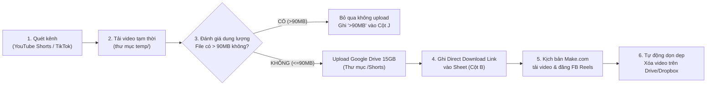

# 📘 TÀI LIỆU DỰ ÁN TỰ ĐỘNG HÓA TIKTOK / YOUTUBE SHORTS → GOOGLE DRIVE / DROPBOX → MAKE.COM → FACEBOOK REELS

> **Ngày cập nhật:** 13/10/2026  
> **Người sở hữu:** Lê Hùng (`@hungleDKH`)  
> **Thư mục dự án:** `D:\AT\Tiktoktodropbox` và `D:\AT\GoogleDrive_OAuth`

---

## 1. 🎯 MỤC TIÊU VÀ QUY TRÌNH HOẠT ĐỘNG (PIPELINE)

Hệ thống hoạt động tự động khép kín theo chu trình sau:


1. **Quét kênh (Scraper):** Tự động phát hiện các video mới nhất từ YouTube Shorts hoặc TikTok theo cấu hình ngày bắt đầu (`start_date`).
2. **Chuẩn hóa Hashtag:** Tự động phát hiện và chuyển đổi tất cả các hashtag liên quan đến `short`, `shorts`, `youtube`, `youtubeshorts`... thành **`#reels`**.
3. **Đánh giá dung lượng an toàn (Cột J):**
   - **Nếu dung lượng file > 90MB:** Bỏ qua không tải lên Google Drive (tránh giới hạn cảnh báo quét virus của Google làm lỗi kịch bản Make), đồng thời **đánh dấu `>90MB` vào Cột J**. Cột `Link file` được để trống.
   - **Nếu dung lượng file $\le$ 90MB:** Tải lên Google Drive, để trống Cột J.
4. **Lưu trữ Cloud (Google Drive 15GB):**
   - Tải video an toàn vào thư mục `Shorts` trên Google Drive (`lehungpharmacist5@gmail.com`).
   - Cấp quyền đọc công khai (`reader / anyone`).
   - **Tạo link tải trực tiếp (Direct Download Link):**
     `https://drive.google.com/uc?export=download&id={FILE_ID}`
     *(Link này trả về trực tiếp stream binary `video/mp4` với mã `HTTP 200`, giúp kịch bản **Make.com** tải và đăng lên Facebook mượt mà).*
5. **Cập nhật Google Sheet:** Lưu Title, Direct Link, Link gốc, độ dài vào sheet chỉ định.
6. **Đăng Facebook Reels (Make.com):** Kịch bản Make.com đọc link từ Google Sheet và đẩy thẳng lên Facebook Reels. Khi đăng xong, Make đánh dấu vào cột **"Đã đăng"** (hoặc điền link Facebook vào cột **"Link"**).
7. **Dọn dẹp giải phóng bộ nhớ (Cleaner):**
   - Chạy công cụ `auto_clean_posted.py` (bằng 1 click trên Desktop hoặc chạy ngầm định kỳ) để tự động xóa các file đã đăng trên Google Drive và Dropbox.
   - Cột **"Đã xóa"** được đánh dấu lại trên Sheet.
8. **Báo cáo khẩn cấp (Telegram Bot):** Bất cứ khi nào có lỗi, sắp hết dung lượng hoặc hoàn thành dọn dẹp, bot `@N10notibot` sẽ tự động gửi thông báo trực tiếp về điện thoại Telegram `@hungleDKH`.

---

## 2. 🗄️ CẤU TRÚC CÁC SHEET (ID: `14tqKftTqlesnb0NqJZU-_f1EsWWywYqO36NiuDdmaTo`)

### Danh sách các Sheet:
| Tên Sheet | Nguồn Video | Nền tảng lưu trữ | Định dạng Link File (Cột B) | Trạng thái |
| :--- | :--- | :--- | :--- | :--- |
| **`Reels`** | TikTok | Dropbox `lehunghup@gmail.com` | `https://dl.dropboxusercontent.com/...` | Đang lưu 1.087 video TikTok cũ |
| **`Reels2`** | YouTube Shorts chính | **Google Drive 15GB** (`lehungpharmacist5@gmail.com`) & Dropbox cũ | `https://drive.google.com/uc?export=download&id=...` *(Chuẩn Make.com)* | Đang lưu **409 video** |
| **`Reels3`** | YouTube Shorts dự phòng | **Google Drive 15GB** (`lehungpharmacist5@gmail.com`) | `https://drive.google.com/uc?export=download&id=...` *(Chuẩn Make.com)* | Sheet phân luồng dự phòng |

---

### Cấu trúc 10 cột chuẩn:
* **Cột A (1):** `Title` — Tiêu đề video đã chuẩn hóa (tự động gắn tag #reels).
* **Cột B (2):** `Link file` — Link tải trực tiếp từ Google Drive (Make.com tải về).
* **Cột C (3):** `thumbnail` — Link ảnh thumbnail.
* **Cột D (4):** `length` — Độ dài video (giây).
* **Cột E (5):** `link youtube videos` — Link gốc trên YouTube Shorts / TikTok.
* **Cột F (6):** `Đã đăng` — Đánh dấu ngày giờ bot đã đăng bài lên Facebook.
* **Cột G (7):** `Đã xóa` — Đánh dấu đã xóa file trên Cloud Storage sau khi đăng.
* **Cột H (8):** *(Để trống / Số thứ tự)*.
* **Cột I (9):** `Link` — Link bài đăng Reels trên Facebook sau khi Make.com đăng thành công.
* **Cột J (10):** **`>90MB`** — Đánh giá dung lượng. Nếu video > 90MB thì ghi `>90MB` và bỏ qua không upload; nếu $\le$ 90MB thì để trống và upload bình thường.

---

## 3. 🔑 HỆ THỐNG TÀI KHOẢN & QUYỀN HẠN OAUTH

### A. Google Drive OAuth 15GB:
* **Email:** `lehungpharmacist5@gmail.com`
* **Google Cloud Project:** `fb-storage-511417`
* **Quyền hạn (Scopes):** Toàn quyền Google Drive (`drive`) + Google Sheets (`spreadsheets`).
* **Thời hạn Token:**
  - **Trạng thái:** **IN PRODUCTION (VĨNH VIỄN)**.
  - App Google Cloud đã được Publish công khai cho cá nhân (`In production` với website xác thực `https://comil.site`).
  - `refresh_token` hiện tại có hiệu lực **vĩnh viễn**, không bao giờ bị hết hạn sau 7 ngày như chế độ Testing.
  - `access_token` tự động làm mới ngầm mỗi 60 phút, không cần đăng nhập lại.

### B. Google Sheets API:
* **Service Account:** `credentials.json` (tự động cấp quyền đọc/ghi Google Sheet).

### C. Thông báo Telegram Bot:
* **Bot cấp báo:** `@N10notibot` (`8089272012:AAGp985KCEFOdMe1iJO_pp2hb8gFD-rV3c4`)
* **Chat ID nhận tin:** `1900957785` (Tài khoản cá nhân: `@hungleDKH`)

---

## 4. 🧹 CÔNG CỤ DỌN DẸP FILE ĐÃ ĐĂNG (`auto_clean_posted.py`)

Hệ thống cung cấp sẵn các cách dọn dẹp cực kỳ thuận tiện:

### Cách 1: Bấm 1 click trên màn hình Desktop
* Biểu tượng shortcut đã được tạo sẵn trên màn hình máy tính:  
  👉 **`Don_Dep_File_Da_Dang.lnk`**  
* Bấm đúp vào biểu tượng này là chương trình sẽ tự động quét cả 3 sheet, xóa hết các video đã đăng trên Google Drive/Dropbox, đánh dấu "Đã xóa" và tự đóng cửa sổ.

### Cách 2: Chạy ngầm tự động định kỳ
* Mở file: [`D:\AT\Tiktoktodropbox\CHAY_NGAM_DINH_KY_XOA_FILE.bat`](file:///D:/AT/Tiktoktodropbox/CHAY_NGAM_DINH_KY_XOA_FILE.bat)
* Tool sẽ chạy ngầm và tự động quét dọn dẹp định kỳ **mỗi 30 phút một lần**.

### Cách 3: Chạy bằng lệnh dòng lệnh
```powershell
cd D:\AT\Tiktoktodropbox
# Chạy 1 lần:
python auto_clean_posted.py

# Chạy lặp lại liên tục mỗi 30 phút:
python auto_clean_posted.py --loop --interval 1800
```

---

## 5. 🐙 HƯỚNG DẪN ĐẨY LÊN GITHUB

Toàn bộ dự án đã được khởi tạo Git (`git init`) và commit ban đầu. File [`.gitignore`](file:///D:/AT/Tiktoktodropbox/.gitignore) đã bảo vệ 100% các file bí mật (không bao giờ lộ `token.json`, `client_secret.json`, `credentials.json`).

Để đưa lên GitHub của bạn:
1. Vào https://github.com/new tạo một repository mới (ví dụ đặt tên `fb-reels-automation`).
2. Mở PowerShell tại `D:\AT\Tiktoktodropbox\` và chạy 2 lệnh sau:
   ```bash
   git remote add origin https://github.com/<tên_tài_khoản_github>/<tên_repo>.git
   git branch -M main
   git push -u origin main
   ```

---

## 6. 🚀 HƯỚNG DẪN MỞ RỘNG THÊM TÀI KHOẢN GOOGLE DRIVE (TĂNG DUNG LƯỢNG MIỄN PHÍ)

### A. Cơ chế mở rộng đa tài khoản (Multi-Drive Storage Pool):
* Toàn bộ các nick Google phụ/mới đều **dùng chung file cấu hình `client_secret.json` hiện tại** (Project `fb-storage-511417` với tên miền xác thực `https://comil.site`). Bạn **không cần tạo lại app Google Cloud hay cài lại website gì cả**.
* Mỗi nick Gmail thêm vào mang lại thêm **+15GB Google Drive** hoàn toàn miễn phí.
* Chế độ **In Production** cho phép tối đa 100 tài khoản kết nối.

### B. Quy chuẩn đặt tên file Token:
* Tài khoản 1 (mặc định): `token.json` (email `lehungpharmacist5@gmail.com`)
* Tài khoản 2: `token_drive2.json`
* Tài khoản 3: `token_drive3.json`
* *(Tất cả các file `token*.json` đã được khai báo trong `.gitignore`, đảm bảo an toàn 100% khi đẩy code lên GitHub).*

### C. Cách lấy Token cho tài khoản mới (Chỉ mất 30 giây):
Chạy lệnh sau tại thư mục dự án:
```powershell
cd D:\AT\Tiktoktodropbox

# Lấy token cho tài khoản số 2:
python get_token.py --output token_drive2.json

# Hoặc lấy token cho tài khoản số 3:
python get_token.py --output token_drive3.json
```
Trình duyệt sẽ mở ra:
1. Đăng nhập nick Google thứ 2 (hoặc thứ 3).
2. Bấm **Nâng cao (Advanced)** $\rightarrow$ **Đi tiếp tới MyDrive (không an toàn)**.
3. Tích chọn đủ 2 quyền Drive & Sheets $\rightarrow$ Bấm **Tiếp tục**.
4. File token Production vĩnh viễn mới sẽ được tạo ngay lập tức.

### D. Cách sử dụng Token mới trong Code:
* **Gán cho script bất kỳ:** Khi khởi tạo `GoogleDriveUploader`, chỉ cần truyền tham số `token_file='token_drive2.json'`:
  ```python
  from drive_uploader import GoogleDriveUploader
  uploader = GoogleDriveUploader(token_file='token_drive2.json')
  ```
* **Chế độ tự động luân phiên (Multi-Drive Pool):**
  Hệ thống kiểm tra dung lượng còn lại của Drive 1: nếu dung lượng khả dụng $< 500$ MB $\rightarrow$ tự động switch sang `token_drive2.json` để tiếp tục upload.
