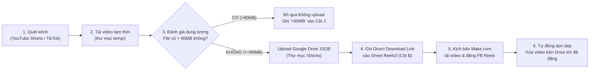

# 📘 TÀI LIỆU DỰ ÁN TỰ ĐỘNG HÓA TIKTOK / YOUTUBE SHORTS → GOOGLE DRIVE / DROPBOX → MAKE.COM → FACEBOOK REELS

> **Ngày cập nhật:** 13/10/2026  
> **Người sở hữu:** Lê Hùng (`@hungleDKH`)  
> **Thư mục dự án:** `D:\AT\Tiktoktodropbox` và `D:\AT\GoogleDrive_OAuth`

---

## 1. 🎯 MỤC TIÊU VÀ QUY TRÌNH HOẠT ĐỘNG (PIPELINE)

Hệ thống hoạt động tự động khép kín theo chu trình sau:


1. **Quét kênh (Scraper):** Tự động phát hiện các video mới nhất từ YouTube Shorts hoặc TikTok theo cấu hình ngày bắt đầu (`start_date`).
2. **Tải video (Downloader):** Tải video mp4 về thư mục tạm `temp/` bằng công nghệ đa luồng (`yt-dlp` kết hợp Node.js & Chrome impersonate).
3. **Đánh giá dung lượng an toàn (Cột J):**
   - **Nếu dung lượng file > 90MB:** Bỏ qua không tải lên Google Drive (để tránh giới hạn cảnh báo quét virus của Google làm lỗi kịch bản Make), đồng thời **đánh dấu `>90MB` vào Cột J**. Cột `Link file` được để trống.
   - **Nếu dung lượng file $\le$ 90MB:** Tải lên Google Drive, để trống Cột J (hoặc ghi nhận an toàn).
4. **Lưu trữ Cloud (Google Drive 15GB):**
   - Tải video an toàn vào thư mục `Shorts` trên Google Drive (`lehungpharmacist5@gmail.com`).
   - Cấp quyền đọc công khai (`reader / anyone`).
   - **Tạo link tải trực tiếp (Direct Download Link):**
     `https://drive.google.com/uc?export=download&id={FILE_ID}`
     *(Link này trả về trực tiếp stream video binary `video/mp4` với mã `HTTP 200`, giúp kịch bản **Make.com** tải và đăng lên Facebook mượt mà).*
5. **Cập nhật Google Sheet:** Lưu Title, Direct Link, Link gốc, độ dài vào sheet chỉ định.
6. **Đăng Facebook Reels (Make.com):** Kịch bản Make.com đọc link từ Google Sheet và đẩy thẳng lên Facebook Reels.
7. **Dọn dẹp giải phóng bộ nhớ (Cleaner):** Khi video được đánh dấu cột **"Đã đăng"**, hệ thống tự động xóa file trên Google Drive để giải phóng dung lượng.
8. **Báo cáo khẩn cấp (Telegram Bot):** Bất cứ khi nào có lỗi, sắp hết dung lượng hoặc hoàn thành tác vụ, bot `@N10notibot` sẽ tự động gửi thông báo trực tiếp về điện thoại Telegram `@hungleDKH`.

---

## 2. 🗄️ CẤU TRÚC CÁC SHEET (ID: `14tqKftTqlesnb0NqJZU-_f1EsWWywYqO36NiuDdmaTo`)

### Danh sách các Sheet:
| Tên Sheet | Nguồn Video | Nền tảng lưu trữ | Định dạng Link File (Cột B) | Trạng thái |
| :--- | :--- | :--- | :--- | :--- |
| **`Reels`** | TikTok | Dropbox `lehunghup@gmail.com` | `https://dl.dropboxusercontent.com/...` | Đang lưu 1.087 video TikTok cũ |
| **`Reels2`** | YouTube Shorts đợt 1 | Dropbox `lehungpharmacist@gmail.com` | `https://dl.dropboxusercontent.com/...` | Lưu 166 video (114 Threads + 52 TaKhongNgu) |
| **`Reels3`** *(Mới)* | YouTube Shorts mới | **Google Drive 15GB** (`lehungpharmacist5@gmail.com`) | `https://drive.google.com/uc?export=download&id=...` *(Chuẩn Make.com)* | Đang dùng cho toàn bộ video YouTube Shorts mới |

---

### Cấu trúc các cột trong Sheet `Reels3`:
* **Cột A (1):** `Title` — Tiêu đề video đã chuẩn hóa (tự động gắn tag #reels).
* **Cột B (2):** `Link file` — Link tải trực tiếp từ Google Drive (Make.com tải về).
* **Cột C (3):** `thumbnail` — Link ảnh thumbnail.
* **Cột D (4):** `length` — Độ dài video (giây).
* **Cột E (5):** `link youtube videos` — Link gốc trên YouTube Shorts.
* **Cột F (6):** `Đã đăng` — Đánh dấu ngày giờ bot đã đăng bài lên Facebook.
* **Cột G (7):** `Đã xóa` — Đánh dấu đã xóa file trên Cloud Storage sau khi đăng.
* **Cột H (8):** *(Để trống / Số thứ tự)*.
* **Cột I (9):** `Link` — Link bài đăng Reels trên Facebook sau khi Make.com đăng thành công.
* **Cột J (10):** **`>90MB`** — Đánh giá dung lượng. Nếu video > 90MB thì ghi `>90MB` và bỏ qua không upload; nếu $\le$ 90MB thì để trống và upload bình thường.

---

## 3. 🔑 HỆ THỐNG TÀI KHOẢN & XÁC THỰC

### A. Google Drive OAuth 15GB (Tài khoản chính):
* **Email:** `lehungpharmacist5@gmail.com`
* **Google Cloud Project:** `fb-storage-511417`
* **Thư mục quản lý:** `D:\AT\GoogleDrive_OAuth\`
  - `client_secret.json`: Chìa khóa cấu hình OAuth từ Cloud Console.
  - `token.json`: Token vĩnh viễn (đã tích hợp `refresh_token`, tự động làm mới ngầm).
  - `drive_uploader.py`: Module upload file và sinh link tải trực tiếp.
  - `DANG_NHAP_LAY_TOKEN.bat`: Click đúp nếu muốn đổi sang tài khoản Gmail khác.

### B. Google Sheets API:
* **Service Account:** `credentials.json` (tự động cấp quyền đọc/ghi Google Sheet).

### C. Thông báo Telegram Bot:
* **Bot cấp báo:** `@N10notibot` (`8089272012:AAGp985KCEFOdMe1iJO_pp2hb8gFD-rV3c4`)
* **Chat ID nhận tin:** `1900957785` (Tài khoản cá nhân: `@hungleDKH`)

---

## 4. 📂 CÁC FILE CHÍNH VÀ CÁCH SỬ DỤNG

| File | Tác dụng |
| :--- | :--- |
| `D:\AT\Tiktoktodropbox\yt-tt-to-sheet-date.py` | Script đồng bộ đa luồng chính. Đã tích hợp Google Drive, kiểm tra >90MB ở Cột J và xuất link vào `Reels3`. |
| `D:\AT\Tiktoktodropbox\drive_uploader.py` | Thư viện upload Google Drive độc lập. |
| `D:\AT\Tiktoktodropbox\config.py` | File cấu hình chung. |
| `D:\AT\Tiktoktodropbox\pending_takhongngu.json` | Danh sách các video YouTube còn chờ tải tiếp. |

### Lệnh chạy đồng bộ:
```powershell
cd D:\AT\Tiktoktodropbox
python yt-tt-to-sheet-date.py
```
